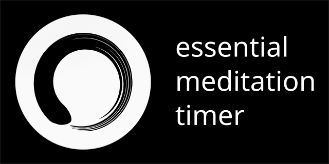

# Meditation (React + Capacitor + PWA)



*This is a meditation timer. Minimalistic, reliable, and truly elegant.*

A 1:1 clone of [jeremies/meditation](https://github.com/jeremies/meditation) rebuilt with **React**, **TypeScript**, **Capacitor** (`@capacitor/local-notifications`), and **Progressive Web App (PWA)** offline support via `vite-plugin-pwa`.

## Features

* **Minimalist Material Dark UI** (`#121212` background, `#212121` surface, `#8C9EFF` indigo accent)
* **10 Authentic Bell & Gong Sounds**:
  * Burma Bell, Three Burma Bells, Indian Bell, Meditation Bell, Singing Bell, Singing Bowl, Big Singing Bowl, Gong, Generated Gong, Alan Watts Gong
* **Configurable Bell Volume** (`0` to `10` slider with instant audio preview)
* **Reliable Countdown Timer & Notifications**:
  * Scheduled start, interval, and end notifications via [`@capacitor/local-notifications`](https://capacitorjs.com/docs/apis/local-notifications) (`allowWhileIdle: true`, custom Android `res/raw` notification sounds, and high-importance notification channels)
  * Pre-meditation delay (`5` to `60` seconds)
  * Intermediate interval bells (`1` to `300` minutes)
  * Screen Wake Lock support (`navigator.wakeLock`) and silent-audio background keep-alive for PWA
* **Meditation Statistics & 52-Week Activity Heatmap**:
  * Current Streak, Best Streak, Total Time, and Total Sessions cards
  * Interactive 52-week heatmap calendar with daily inspection banner
  * Recent sessions history and Danger Zone history reset

## Development

```bash
# Install dependencies
npm install

# Start Vite dev server
npm run dev

# Run Vitest unit & component test suite
npm test

# Build production PWA bundle
npm run build

# Sync web assets and plugins with Capacitor Android
npm run cap:sync
```
